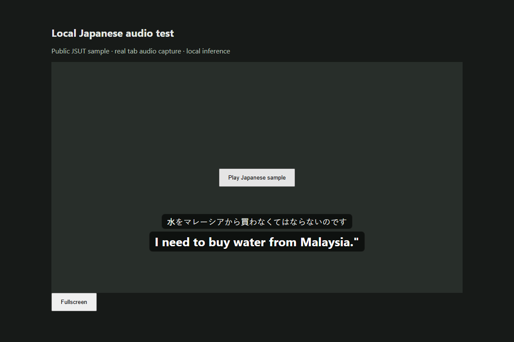

# Local Stream Subtitles

Live English subtitles over YouTube videos and livestreams, using speech recognition
and translation on your own PC. Built for Japanese streams, including speakers who
switch between Japanese and English. No paid API or account is needed for inference.



**Windows + NVIDIA preview.** The extension and local service are MIT-licensed.
Downloaded models and runtime components retain their own licenses; see
[third-party notices](THIRD_PARTY_NOTICES.md). This is an early release, with manual
Chrome installation and hardware-dependent latency.

## Install

You need Windows 10/11, Chrome 116 or newer, an NVIDIA GPU supported by CUDA 12,
an up-to-date NVIDIA driver, and several gigabytes of free disk space. The reference
machine has a Ryzen 5 3600, 32 GB RAM, and an RTX 3070 with 8 GB VRAM. Other hardware
profiles, CPU-only use, macOS, and Linux are not validated by the Windows launcher.

1. Download or clone the source into a writable folder and extract it if necessary.
2. Double-click **`setup.bat`**. Initial setup downloads local Python, Ollama, GPU
   libraries, and models. It can take several minutes. No separate Ollama install
   or global `PATH` change is required.
3. Double-click **`start.bat`** and wait for **Local subtitles ready**. Keep that
   window open while watching. The first GPU warm-up can take a few minutes.
4. Open `chrome://extensions`, enable **Developer mode**, choose **Load unpacked**,
   and select the source folder's **`extension`** directory.
5. Refresh any YouTube tabs that were already open. Open a video or livestream,
   click the extension icon, and select **Start subtitles**.

Click **Stop** in the extension to stop capture. Press **Ctrl+C** in the launcher
window to stop the project services. For a background launch, use
`powershell -NoProfile -File stop.ps1` when finished.

After updating source, stop and restart the service, reload the extension at
`chrome://extensions`, and refresh YouTube. Reloading only the popup does not reload
the running Python service or an already-injected content script.

## What it does

- Captures the selected YouTube tab's audio, without requesting your microphone.
- Uses local Whisper Turbo to recognize speech and detect the language of each
  buffered utterance.
- Displays confidently recognized English directly, without translating it again.
- Uses local Ollama to translate Japanese, uncertain, and mixed-language text into
  English, with a small amount of recent dialogue as context.
- Shows subtitles inside the player, including fullscreen, with optional Japanese
  text and three font sizes.
- Stops capture when the video page changes, and bounds queued audio so a slow
  model does not accumulate an ever-growing delay.

The default profile is faster-whisper `turbo` with CUDA `int8_float16`, followed by
`qwen3:4b-instruct-2507-q4_K_M`. This is the non-reasoning Apache-2.0 Qwen3 Instruct
variant; it is different from the older reasoning `qwen3:4b` tag. Context mode is
enabled. Direct speech translation is disabled for Turbo, which is a transcription
model rather than a direct translation model.

## Limits and current testing

Expect subtitles a few seconds behind speech. The service waits for a short pause
or roughly five seconds of audio before inference. Very short utterances and
Japanese/English switches within the same buffer can confuse language detection.
Clear solo speech works best; game audio, singing, overlapping voices, names, and
slang can still produce incorrect or missing subtitles.

The earlier prototype was tested on the reference RTX 3070 with Whisper Turbo and
`qwen2.5:3b`: a clean 3.19-second Japanese sample took 0.312–0.5 seconds for
transcription and translation after warm-up. That is a historical single-sample
measurement, not an accuracy score, a latency guarantee, or a benchmark of the new
Qwen3 Instruct default.

The new Qwen3 Instruct tag was checked separately with short Japanese and mixed
Japanese/English text prompts on an isolated CPU-only Ollama instance. It returned
concise English without reasoning output. The checked model digest was
`0edcdef34593eac1aa2be9c7d06c432dcf81945adca5eca2f27662c18f168ba0`.
This validates the text path, not end-to-end live-stream accuracy or GPU latency.

Browser integration has exercised real tab capture, local translated captions,
fullscreen, stop/restart, and YouTube-style navigation using a controlled page.
Bilingual routing has regression tests. The specific reported live-stream switching
failure has not yet been replayed after the fix. The Qwen3 Instruct profile's live
GPU latency and quality should be measured separately before claiming parity with
the historical profile.

## Model selection and earlier installations

Setup preserves an existing model selection. To move from the earlier
`qwen2.5:3b` preview to the Apache-licensed default, stop the service and run:

```powershell
powershell -NoProfile -ExecutionPolicy Bypass -File setup.ps1 -TranslationModel qwen3:4b-instruct-2507-q4_K_M
```

Then restart the service and reload the extension. The earlier Qwen 2.5 3B weights
use a research license with restrictions; the project's MIT License does not
override those terms. Model files are downloaded separately and are not in this
repository.

## Local processing and privacy

During normal use, audio and subtitles are processed in memory, not saved by the
app. The subtitle service listens on `127.0.0.1:8765`; its Ollama connection is fixed
to `127.0.0.1:11434`, with cloud features disabled for the project process. Setup
downloads software and models from upstream providers. Do not expose these ports
to your network.

Each setup creates local pairing information. `.runtime/settings.json` and
`extension/local-config.json` are ignored by Git and must never be shared. Other
local-only directories include `.venv`, `models`, `node_modules`, and browser test
profiles. Share a clean source checkout, not your configured project folder.
See [SECURITY.md](SECURITY.md) for reporting and handling exposed local credentials.

## Troubleshooting

| Symptom | Next step |
| --- | --- |
| Local service not found | Run `start.bat`, wait for warm-up, then refresh the service status in the popup. |
| No captions | Confirm Japanese or English speech is playing; refresh YouTube, then stop/start capture. Silence and music can be filtered out. |
| Gibberish after a language switch | Update, restart the service, reload the extension, and report a public timestamp if it persists. Short mixed buffers remain difficult. |
| Port already in use | Stop the earlier project process or unrelated service on port 8765/11434. The launcher will not take over another installation. |
| GPU memory error | Close GPU-heavy applications and restart the project service. |
| Pairing error | Rerun setup, restart the service, reload the extension, and refresh YouTube. |
| Startup failure | Check `.runtime/subtitle-service.err.log`, removing sensitive material before sharing excerpts. |

## Development

The loadable extension is plain JavaScript and needs no frontend build. Python
requirements and the npm lockfile describe dependencies; the Windows installer uses
the tested Python lockfile. Models, NVIDIA libraries, and runtime binaries are
installed locally rather than committed.

```powershell
npm ci
.venv\Scripts\python.exe -m pip install -r requirements-dev.txt
npm test
.venv\Scripts\python.exe -m pytest -q tests/test_backend.py
powershell -NoProfile -File tests/test_launchers.ps1
.venv\Scripts\python.exe -m scripts.check_release
```

Unit tests use mocked inference and require no GPU, model downloads, or paid API.
GitHub Actions runs those tests plus Windows launcher isolation checks. Real GPU
and browser integration checks run locally; they are not covered by hosted CI.

The optional `npm run test:browser` check needs the service running and a public
`.runtime/streaming-sample.wav` fixture. It uses a separate browser profile and
auto-detects installed Chrome on Windows; `CHROME_PATH` overrides the executable.
Its debugging controls require a recent Chrome, beyond the extension's production
minimum. The historical sample is from [JSUT basic5000](https://huggingface.co/datasets/FluidInference/JSUT-basic5000).

```text
YouTube tab -> offscreen AudioWorklet -> PCM16 / local WebSocket
            -> Whisper -> English passthrough or Ollama translation
            -> subtitle overlay inside the YouTube player
```

Read [CONTRIBUTING.md](CONTRIBUTING.md) before reporting bugs or opening a pull
request. Similar public projects include [yt-realtime-translate](https://github.com/minh1997/yt-realtime-translate)
and [live-subtitle](https://github.com/xu-0306/live-subtitle). This implementation
focuses on a small, self-contained Windows setup and a local player overlay.
